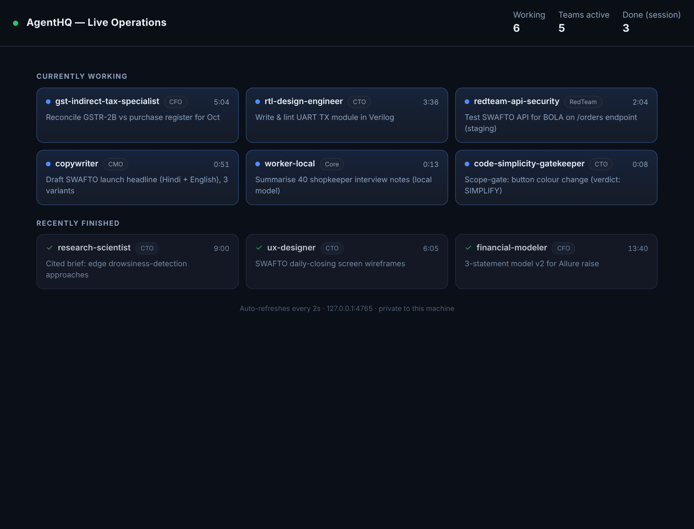

# AgentHQ

**A ready-made AI company that runs inside Claude Code.** AgentHQ gives you 345 specialist agents and 259 skills, organised into 17 teams. Each team is led by an executive mode you switch into with a slash command (`/cto`, `/cfo`, `/gc`, `/qa`, `/sharks`, and so on). Leaders plan the work, delegate it to specialists, and have specialists hand small tasks to workers on the cheapest model that can do them well. You stay the decision-maker: agents produce drafts, plans and analysis, and nothing is sent, signed, paid, deployed or deleted without your approval.

Beyond the agents, AgentHQ includes cost-aware model routing, a learning loop that improves skills from real use (you approve every change), agent-to-agent messaging, a live dashboard that shows who is working on what, and an authorised red team that tests your own applications.



---

## Contents

1. [At a glance](#at-a-glance)
2. [Who it is for](#who-it-is-for)
3. [How it works](#how-it-works)
4. [The teams](#the-teams)
5. [Core systems](#core-systems)
6. [Safety and guardrails](#safety-and-guardrails)
7. [Installation](#installation)
8. [Quick start](#quick-start)
9. [Documentation](#documentation)
10. [FAQ](#faq)
11. [Limitations](#limitations)
12. [Status and license](#status-and-license)

---

## At a glance

| Item | Value |
|---|---|
| Teams | 17 (16 leader modes plus a shared core team) |
| Specialist agents | 345 in total: 217 role and worker agents, 95 investor sharks, 33 customer-panel agents |
| Skills | 259 standards, checklists and procedures the agents follow |
| Slash commands | 17: `/hq`, `/ceo`, `/cto`, `/cpo`, `/cdo`, `/cmo`, `/cro`, `/cfo`, `/coo`, `/chro`, `/gc`, `/agency`, `/redteam`, `/qa`, `/panel`, `/sharks`, `/evolve` |
| Model routing | Five tiers, C0 to C4: local open-weight model, Haiku, Sonnet, Opus, and Opus with independent verification |
| Approval gates | Founder approval for money, external contact, deploys, pushes to main, deletions, and starred pipeline gates |
| Live dashboard | `http://127.0.0.1:4765/`, opens when a team starts working |
| Platform | Claude Code, Python 3, optional Ollama for the free local model |
| Install | `install\Install-Windows.bat` (Windows) or `install/Install-Mac.command` (macOS) |

---

## Who it is for

AgentHQ is built for a **founder or small team running several ventures at once** who needs the functions a company normally pays for, without hiring for each one. The repository is set up around hardware and IoT, SaaS, mobile apps, AI, drones and client services, and it covers the work that usually stalls a small company:

| Problem | What AgentHQ gives you |
|---|---|
| No finance, tax or compliance person on hand | `/cfo` covers books, GST and direct tax, TDS, payroll, cap tables, grants, runway and compliance calendars |
| No lawyer for every contract, NDA or policy | `/gc` drafts and reviews contracts, prepares issue lists for your lawyer, and tracks IP, privacy and employment matters |
| Hiring, HR policy and labour compliance | `/chro` covers hiring, pay bands, performance, POSH, and labour-code compliance |
| Product work with no product manager | `/cpo` runs discovery, PRDs, roadmaps, design and product analytics |
| Engineering across firmware, PCBs, chips, cloud and apps | `/cto` plans and staffs builds through a gated pipeline, with security review at each gate |
| Marketing, sales and tenders with a small budget | `/cmo`, `/cro` and `/agency` cover campaigns, copy, funnels, pipelines, bids and client proposals |
| Testing that real users would find | `/qa` injects failures, simulates human error, runs load and concurrency tests, and drives a real Android phone |
| Feedback before you spend money | `/panel` tests an idea and an app with 32 customer personas; `/sharks` stress-tests an idea and a raise plan with investor archetypes |
| Security testing of your own systems | `/redteam` tests your own apps and reports findings privately, with severity and fixes |
| Paying for AI tokens on routine work | Model routing sends simple work to cheaper tiers, and to a local model when one is installed |
| Repeating the same mistakes | A learning loop stores lessons per agent, and `/evolve` proposes skill upgrades for your approval |

---

## How it works

### The layers

```
You (founder, final decisions)
└── Leader mode            /ceo /cto /cfo ...       plans, delegates, reports
    └── Specialist agents  one per role              owns a work package
        └── Worker agents  C0 to C4 by cost         one atomic task each
            └── Verifier   worker-verifier          independent check on important output
```

- **Leader (executive mode).** Type a slash command such as `/cfo` and Claude Code switches into that leader's mode. The leader breaks your goal into a task tree, records it in a `TASKS.md` file in the team's folder, assigns specialists, and reports back.
- **Specialist.** Each specialist is a Claude Code subagent with its own role, model and preloaded skills. A specialist owns one work package and can spawn workers for small pieces.
- **Worker.** Workers do one atomic task each, on the cheapest model that will do it well (see the model tiers below).
- **Verifier.** `worker-verifier` independently checks important outputs before anything is integrated.

Nesting is capped at three levels below the main session.

### The gated pipeline

For product work, AgentHQ follows a staged pipeline. Stages marked with `*` need your explicit approval before the work moves on:

```
RESEARCH → PRD* → ARCHITECTURE* (+ threat model) → BUILD → ALPHA (+ security sign-off) → BETA* → RELEASE*
```

Each team also runs its own gate reviews before a stage change, for example `stage-gate-review` (CTO), `campaign-gate-review` (CMO), `finance-review-gate` (CFO) and `ops-review-gate` (COO). Each gate asks for evidence and a go/no-go.

Scenario presets (S1 to S9) decide which specialists join a project. The presets cover connected IoT devices, edge-AI devices, custom chips, AI/ML products, SaaS platforms, Android and mobile apps, robotics, research papers and internal automation.

### Model routing tiers

Every non-trivial task is split into atomic tasks, and each atomic task goes to the cheapest tier that can do it well:

| Tier | Typical task | Worker | Model |
|---|---|---|---|
| C0 trivial | Reformat, summarise, translate, classify, extract, boilerplate | `worker-local` | Open-weight model through Ollama (free, offline, private) |
| C1 simple | Lookups, small edits, template fill, simple scripts | `worker-haiku` | Claude Haiku |
| C2 standard | Write a function or module, draft a section, data analysis, sourced research | `worker-sonnet` | Claude Sonnet |
| C3 complex | Architecture, hard debugging, legal, financial or strategy reasoning, synthesis | `worker-opus` | Claude Opus |
| C4 critical | Anything binding, involving money, safety, security or production, or external | `worker-opus` + `worker-verifier` + your approval | Opus with an independent check |

Rules that always apply: a task that fails twice or fails verification moves up one tier. Confidential data stays on the local model or on Claude, never on third-party tools. C3 and C4 work is never sent to the local model alone.

---

## The teams

| # | Team | Command | Agents | Skills | What it is for |
|---|---|---|---|---|---|
| 1 | Front desk | `/hq` | 0 | 1 | Routes a plain-language request to the right leader |
| 2 | CEO, Office of the CEO | `/ceo` | 13 | 17 | Strategy, venture focus, fundraising, governance, big decisions |
| 3 | CTO, Engineering | `/cto` | 32 | 35 | Hardware, firmware, chips, software, AI/ML and security builds |
| 4 | CPO, Product | `/cpo` | 10 | 13 | Discovery, roadmaps, specs, design and product analytics |
| 5 | CDO, Data & AI | `/cdo` | 10 | 13 | Data platform, dashboards, AI strategy, evaluation, responsible AI |
| 6 | CMO, Marketing | `/cmo` | 25 | 30 | Brand, positioning, content, growth, paid ads, PR, founder brand |
| 7 | CRO, Sales & revenue | `/cro` | 12 | 15 | Pipeline, deals, pricing, key accounts, channel partners, tenders |
| 8 | CFO, Finance | `/cfo` | 20 | 23 | Books, tax, GST, payroll, FP&A, cap table, grants, controls |
| 9 | COO, Operations | `/coo` | 20 | 24 | Supply chain, manufacturing, certifications, support, vendors, hiring ops |
| 10 | CHRO, HR | `/chro` | 16 | 19 | Hiring, pay, performance, culture, employee relations, labour compliance |
| 11 | GC, Legal | `/gc` | 14 | 17 | Contracts, corporate, IP, privacy, employment, regulatory, disputes |
| 12 | Agency, Client services | `/agency` | 12 | 15 | Pitches, proposals, SOWs, delivery, resourcing, agency profitability |
| 13 | Red Team, Security testing | `/redteam` | 13 | 5 | Authorised security testing of your own applications |
| 14 | QA & Reliability, Testing | `/qa` | 13 | 15 | Failure injection, load, human error, concurrency, real-device testing |
| 15 | Customer Panel, Persona testers | `/panel` | 33 | 5 | Idea and app verdicts from 32 customer personas |
| 16 | Investor Panel, The sharks | `/sharks` | 95 | 7 | Investability verdicts and a roadmap to the first check |
| 17 | Core, Workers and self-improvement | (shared, plus `/evolve`) | 7 | 5 | Model-tier workers, verifier, skill curator, agent architect |

Totals: **345 agents**, **259 skills**, **17 teams**. Each team's full roster is in its document under [docs/teams/](docs/teams/).

Agents are listed below by function. The short phrase after each name says what that agent does. Model choice is set per agent: most specialists run on Sonnet, the hardest roles run on Opus, and the persona and shark agents run on Haiku.

---

### 1. Front desk: `/hq`

**Command:** `/hq` · **Agents:** 0 (uses one skill) · **Skills:** 1 · [Team doc](docs/teams/hq.md)

**Mission.** The front desk is the entry point when you do not know which leader you need. It lists every executive mode and routes your request to the right one. It does not do the work itself.

**Agents.** None. The team is a single skill, `hq`, which covers CEO, CTO, CMO, CFO, COO, CHRO, GC, CRO, CPO, CDO and Agency.

**Example prompts**
- `/hq a vendor hasn't paid us for 4 months, what are my options?`
- `/hq should I take a government tender for smart bus stops?`

---

### 2. CEO, Office of the CEO: `/ceo`

**Command:** `/ceo` · **Agents:** 13 · **Skills:** 17 · [Team doc](docs/teams/ceo.md)

**Mission.** Company-level decisions. The CEO office frames a question, decides which executive teams need to be involved, and produces one plan with owners and the decisions you must make. It covers venture focus (invest, hold or kill), fundraising, governance, ecosystem relations and the weekly company review.

**Strategy and portfolio**
- `chief-strategy-officer`: company strategy, venture focus (invest, hold or kill), annual planning
- `venture-studio-analyst`: evaluates new ideas with validation experiments and go/no-go criteria
- `red-team-strategist`: pre-mortems, assumption audits and counter-arguments before big commitments

**Capital and partnerships**
- `investor-relations-lead`: fundraising strategy, investor targeting and pipeline
- `corporate-development-lead`: partnerships, business development, M&A thesis and deal memos

**Governance and leadership**
- `board-governance-advisor`: board packs, advisory board, decision rights
- `org-leadership-advisor`: org design, leadership team, co-founder search
- `legal-strategy-liaison`: issue lists and questions to prepare for lawyers (business terms, not legal advice)

**Ecosystem and communications**
- `ecosystem-government-relations`: Startup India and Odisha schemes, incubators, ministries, awards
- `executive-communications-lead`: memos, all-hands and stakeholder letters in your voice
- `crisis-management-advisor`: crisis triage, war room, stakeholder comms, post-mortem

**Office**
- `business-intelligence-analyst`: company-wide KPI scorecard and weekly dashboard
- `founder-executive-assistant`: weekly review, priorities, calendar design, meeting briefs

**Example prompts**
- `/ceo Which two of my ventures should I focus on for the next six months? Current status: [...]`
- `/ceo Should I raise a pre-seed now or wait six months? Runway is [x] months.`

---

### 3. CTO, Engineering: `/cto`

**Command:** `/cto` · **Agents:** 32 · **Skills:** 35 · [Team doc](docs/teams/cto.md)

**Mission.** Engineering across the stack: hardware, firmware, silicon, software, AI/ML, platform and security. The CTO runs the project scenarios, applies the gated pipeline, and checks each gate with evidence. The main session runs as `cto` by default, so plain requests in a project folder go through this team. Every coding task first passes `code-simplicity-gatekeeper`, which asks why the code is needed and what the smallest change is.

**Leadership and planning**
- `cto`: plans, staffs, delegates and reports to you
- `program-manager`: task breakdown, dependencies, risks and `STATUS.md`
- `product-manager`: PRDs, user stories, acceptance criteria and release scope
- `research-scientist`: literature, patents, datasheets and competitor research with citations

**Architecture and security**
- `system-architect`: end-to-end architecture across device, firmware, cloud, ML and apps, with ADRs
- `security-architect`: threat models, security requirements and sign-off at each gate
- `appsec-engineer`: OWASP review, SAST, secrets and dependency scans
- `cloud-security-engineer`: IAM, network, secrets, logging and misconfiguration scans
- `ai-security-engineer`: prompt injection, data poisoning, leakage and the OWASP LLM Top 10
- `firmware-hardware-security-engineer`: secure boot, signed OTA, debug lockdown, key storage
- `privacy-compliance-officer`: DPDP and GDPR privacy, consent, retention, and device certifications

**Hardware and firmware**
- `embedded-firmware-engineer`: ESP32, STM32, RP2040 and Arduino drivers, RTOS, comms and OTA
- `pcb-hardware-engineer`: schematics, PCB layout review, BOM, power and DFM in KiCad
- `robotics-engineer`: ROS 2, PX4 and ArduPilot, drones, rovers and swarms, with simulation

**Silicon**
- `chip-architect`: micro-architecture, register maps and PPA targets before any RTL
- `rtl-design-engineer`: synthesizable Verilog and SystemVerilog, lint and Yosys synthesis
- `design-verification-engineer`: cocotb and Verilator testbenches, assertions, coverage and formal checks
- `physical-design-engineer`: OpenLane 2 and OpenROAD RTL-to-GDSII, STA, DRC and LVS

**AI and data**
- `ml-research-engineer`: designs and trains ML and DL models, evaluation and edge quantization
- `data-engineer`: datasets, pipelines, labelling and data contracts
- `llm-applications-engineer`: RAG, tool-using agents, prompts and evals with Claude or Ollama
- `mlops-engineer`: model packaging, serving, CI evaluation gates and monitoring

**Software and platform**
- `backend-engineer`: APIs, databases, authentication and IoT ingestion
- `frontend-engineer`: React and Next.js web apps and dashboards
- `android-engineer`: Kotlin and Compose apps, offline-first, BLE
- `devops-sre-engineer`: Terraform, CI/CD, containers, reliability and cost

**Design, quality and release**
- `ux-designer`: user flows, wireframes and UX copy
- `qa-test-engineer`: alpha testing, regression, bug reports and sign-off
- `hil-test-engineer`: hardware-in-the-loop, bench, environmental and soak tests
- `beta-program-manager`: beta and field trials, feedback triage and go/no-go
- `code-simplicity-gatekeeper`: reviews each coding request before work starts, and cleans finished code

**Docs**
- `tech-writer`: READMEs, API docs, datasheets, manuals and release notes

**Example prompts**
- `/cto Design the architecture for a fleet of 500 devices with remote content updates and offline playback.`
- `/cto Security review of my backend before launch, with findings ranked by severity.`

---

### 4. CPO, Product: `/cpo`

**Command:** `/cpo` · **Agents:** 10 · **Skills:** 13 · [Team doc](docs/teams/cpo.md)

**Mission.** Product direction and delivery: discovery before building, a roadmap you can defend, specs the engineers can test against, and the analytics that show whether a feature worked. The CPO also covers onboarding, activation and monetisation experiments.

**Strategy and roadmap**
- `product-strategist`: product vision, north-star metric and big bets with kill criteria
- `roadmap-portfolio-manager`: roadmaps and prioritisation across products and ventures

**Discovery and research**
- `product-manager-discovery`: opportunity solution trees, assumption tests and prototypes
- `user-researcher`: research plans, interview guides, usability tests, surveys and synthesis

**Specs and delivery**
- `product-manager-delivery`: PRDs, user stories, acceptance criteria and release planning
- `technical-product-manager`: platform, API, device-app-cloud and AI feature requirements

**Design**
- `product-designer`: user flows, wireframes, prototypes, UI specs and accessibility
- `design-system-lead`: design tokens, components and patterns across products

**Data and growth**
- `product-analytics-lead`: tracking plans, funnels, cohorts and A/B test readouts
- `growth-product-manager`: onboarding, activation, retention and monetisation experiments

**Example prompts**
- `/cpo Plan ten user interviews with shop owners and give me the interview guide in English and Hindi.`
- `/cpo Write a PRD for a daily summary feature, with testable acceptance criteria.`

---

### 5. CDO, Data & AI: `/cdo`

**Command:** `/cdo` · **Agents:** 10 · **Skills:** 13 · [Team doc](docs/teams/cdo.md)

**Mission.** Data and AI across the company: which AI use cases are worth building, how to evaluate them, how data is modelled and governed, and how AI is used safely inside the team.

**AI strategy and delivery**
- `ai-strategy-lead`: use-case portfolio scored on value and feasibility, build-vs-buy, AI roadmap
- `applied-ai-lead`: proofs of concept, RAG, agents and document AI with Claude or local models

**AI quality and governance**
- `ai-evaluation-engineer`: evaluation suites, quality and safety metrics, regression tests and red-teaming
- `responsible-ai-lead`: AI policy, risk assessments, bias testing and human oversight
- `ai-adoption-lead`: internal AI tooling rules, prompt libraries, agent workflows and training

**Data platform**
- `data-platform-architect`: warehouse or lakehouse design, ingestion, IoT telemetry and cost
- `analytics-engineer`: layered data models, tests and the semantic layer
- `data-governance-lead`: data catalog, ownership, quality rules, retention and DPDP alignment

**Analytics**
- `data-scientist`: forecasting, segmentation, churn, pricing and causal analysis
- `bi-analyst`: dashboards and analysis for leadership and ventures

**Example prompts**
- `/cdo List the top five AI use cases across my ventures, ranked by value and effort.`
- `/cdo Build an evaluation plan for a WhatsApp support bot, including a golden dataset and pass thresholds.`

---

### 6. CMO, Marketing: `/cmo`

**Command:** `/cmo` · **Agents:** 25 · **Skills:** 30 · [Team doc](docs/teams/cmo.md)

**Mission.** Marketing from positioning to measurement: who the customer is, what to say, where to say it, what it costs, and whether it worked. Copy is written in English, Hindi and Hinglish. Every campaign passes a compliance review before it goes live.

**Strategy and brand**
- `brand-strategist`: brand platform, voice and visual guidelines
- `product-marketing-manager`: positioning, messaging, pricing input and launch plans
- `customer-insights-researcher`: ideal customer profile, personas, jobs-to-be-done and review mining
- `market-research-analyst`: market sizing and segments, with cited sources
- `competitive-intelligence-analyst`: competitor positioning, pricing and battlecards

**Content and creative**
- `content-strategist`: content pillars, calendars and repurposing
- `copywriter`: conversion copy for web, ads, email, WhatsApp and social
- `creative-director`: creative concepts and briefs for ads, posters, decks and packaging
- `video-producer`: scripts, storyboards, reels and demos
- `social-media-manager`: organic social strategy and post drafts
- `pr-communications-manager`: press releases, media pitches and crisis communications

**Growth and performance**
- `growth-marketer`: funnel analysis, experiments, referral loops and activation
- `performance-marketer`: paid-ads plans on Meta, Google, YouTube and LinkedIn (spend needs approval)
- `seo-specialist`: keyword research, on-page and technical SEO, local SEO
- `app-store-optimizer`: Play Store and App Store listings, keywords, screenshots and ratings
- `lifecycle-crm-marketer`: email, WhatsApp and SMS journeys with consent
- `influencer-partnerships-manager`: creator partnerships with ASCI disclosure
- `marketing-analyst`: tracking plans, UTMs, attribution, CAC, LTV and cohorts

**Founder, community and fundraising**
- `founder-brand-strategist`: your personal brand on LinkedIn and X, speaking and podcasts
- `community-manager`: user, maker, developer and campus communities
- `events-manager`: events, hackathons, competitions and grant applications
- `investor-narrative-strategist`: fundraising story, deck outline, one-pagers and investor updates
- `sales-enablement-manager`: B2B collateral, case studies, ABM and tender support

**Governance**
- `marketing-compliance-reviewer`: checks every campaign for ASCI, consumer-protection, DPDP, TRAI and platform rules before launch
- `marketing-program-manager`: marketing calendar, budgets, approvals and status

**Example prompts**
- `/cmo Launch the product to small shops in one city with a small budget, with a 60-day plan and channel mix.`
- `/cmo Build my founder brand on LinkedIn: a 90-day content plan and the first five posts.`

---

### 7. CRO, Sales & revenue: `/cro`

**Command:** `/cro` · **Agents:** 12 · **Skills:** 15 · [Team doc](docs/teams/cro.md)

**Mission.** Revenue from first contact to renewal: who to sell to, how to reach them, how to price a deal, how to close it, and how to win public-sector tenders. The CRO also runs channel partners and key accounts.

**Revenue strategy**
- `sales-strategy-lead`: ideal customer profile, segments, sales motion and targets
- `pricing-strategist`: price books, packaging, value metrics and pilot-to-paid conversion
- `revenue-intelligence-analyst`: win and loss analysis, churn, expansion and funnel conversion

**Pipeline and deals**
- `sales-development-rep`: prospect research, qualification and outreach drafts
- `account-executive`: discovery, demos, proposals, objection handling and closing
- `solutions-engineer`: solution design, proof-of-concept plans and ROI calculators
- `deal-desk-analyst`: quotes, discount approvals and non-standard terms routing

**Accounts and channels**
- `key-account-manager`: account plans, QBRs, renewals and expansion
- `channel-partner-manager`: reseller and distributor programmes, margins and conflict rules
- `tender-bid-manager`: GeM and state tenders, bid or no-bid decisions, compliance matrices and bid drafts

**Enablement and operations**
- `sales-enablement-trainer`: playbooks, battlecards, call reviews and seller onboarding
- `sales-operations-analyst`: CRM design, stage definitions, pipeline hygiene and forecasting

**Example prompts**
- `/cro Find suitable GeM and state tenders for [product] and give me a bid or no-bid recommendation.`
- `/cro Write a pilot proposal for a fleet of 50 vehicles, with success criteria and pricing options.`

---

### 8. CFO, Finance: `/cfo`

**Command:** `/cfo` · **Agents:** 20 · **Skills:** 23 · [Team doc](docs/teams/cfo.md)

**Mission.** Finance and compliance for an Indian company, with outputs prepared as drafts for your CA or CS to review. Covers the books, the month-end close, tax and filings, runway, capital structure, grants, and controls.

**Books and cost**
- `bookkeeper-accountant`: categorisation and bank reconciliation from Tally, Zoho or bank exports
- `financial-controller`: books, month-end close and financial statements
- `cost-accountant`: BOM and landed costs, inventory, and per-venture P&L

**Planning and analysis**
- `fpa-analyst`: budgets, rolling forecasts, 13-week cash, burn and runway
- `financial-modeler`: three-statement models, scenarios and sensitivities
- `finance-data-analyst`: finance KPI dashboards and automation from exports
- `unit-economics-pricing-analyst`: CAC, LTV, payback and margins
- `valuation-analyst`: valuation ranges from comparables, DCF and the VC method

**Tax and compliance**
- `direct-tax-tds-specialist`: income tax, advance tax, TDS and startup tax benefits
- `gst-indirect-tax-specialist`: GST returns, input tax credit reconciliation and import duty
- `company-secretary-compliance`: MCA and ROC calendar, board and AGM minutes, statutory registers
- `payroll-people-cost-specialist`: payroll, PF, ESI, professional tax and people-cost planning

**Capital and funding**
- `cap-table-equity-manager`: cap table, dilution, ESOP pool and instrument conversions
- `fundraising-finance-analyst`: data room, due-diligence readiness and term-sheet economics
- `grants-schemes-specialist`: Indian startup grants and schemes, with utilisation tracking

**Controls, cash and risk**
- `internal-audit-controls`: approval matrix, fraud red flags and audit readiness
- `payables-procurement-analyst`: vendor onboarding, purchase orders, three-way match and MSME payment rules
- `revenue-billing-analyst`: invoicing, subscription billing and receivables
- `treasury-cash-manager`: cash position, payment calendar and collections (plans only, no money movement)
- `risk-insurance-analyst`: risk register, insurance gaps and FX exposure

**Example prompts**
- `/cfo What are my company's compliance deadlines for the next 90 days?`
- `/cfo Calculate burn and runway from this bank statement: [path]`

---

### 9. COO, Operations: `/coo`

**Command:** `/coo` · **Agents:** 20 · **Skills:** 24 · [Team doc](docs/teams/coo.md)

**Mission.** Running the company and its hardware: processes, supply chain, contract manufacturing, quality, certifications, field deployments, customer support and vendors. It also keeps the company's operating rhythm (OKRs and weekly review).

**Operations and process**
- `chief-of-staff`: OKRs, weekly business reviews, decision log and cross-venture priorities
- `business-process-engineer`: process maps, SOPs and RACI
- `program-delivery-manager`: schedules, critical path, RAID logs and milestones for competitions, projects, tenders and grants
- `ops-analyst`: operations KPIs, capacity and cost-to-serve
- `automation-ops-engineer`: no-code and script automation of repetitive work
- `business-continuity-risk-manager`: operational risk register and business continuity plans

**Supply chain and manufacturing**
- `supply-chain-manager`: demand and material planning, BOM risk and lead times
- `strategic-sourcing-specialist`: RFQs, supplier comparison and sample evaluation
- `logistics-inventory-manager`: warehousing, stock levels, shipping partners and returns
- `manufacturing-operations-engineer`: contract manufacturing, EVT, DVT and PVT builds, yield
- `quality-assurance-manager`: incoming and final QC, CAPA, supplier quality and ISO 9001 readiness

**Field, support and IT**
- `field-operations-manager`: site surveys, installations, technicians and uptime for deployed devices
- `customer-support-ops-manager`: support channels, tiers, SLAs, macros and escalations
- `customer-success-manager`: onboarding, health scores, adoption and renewals
- `it-admin-ops-manager`: device and account inventory, access lifecycle and backups

**Compliance, vendors and hiring operations**
- `regulatory-certification-manager`: BIS, WPC, TEC, DGCA and e-waste EPR applicability, labs and timelines
- `vendor-partner-manager`: vendor onboarding, scorecards, SLAs and partner playbooks
- `contracts-operations-coordinator`: contract templates, clause checklists, register and renewals (not legal advice)
- `people-ops-hr-manager`: org design, policies, performance cadence and labour compliance
- `talent-acquisition-specialist`: role scorecards, job descriptions, structured interviews and offers

**Example prompts**
- `/coo Plan a 50-unit pilot build: parts sourcing, contract manufacturer options, QC and timeline.`
- `/coo What certifications does my device need in India, and what do they cost and take?`

---

### 10. CHRO, HR: `/chro`

**Command:** `/chro` · **Agents:** 16 · **Skills:** 19 · [Team doc](docs/teams/chro.md)

**Mission.** People operations for a small Indian company: hiring, pay, performance, learning, culture, employee relations, and compliance with the four Labour Codes and POSH. Any grievance or investigation follows a fair process.

**Hiring and onboarding**
- `recruiter`: full-cycle recruiting with scorecards, interview loops, debriefs and offer recommendations
- `sourcing-specialist`: sourcing strategy, boolean searches, campus and community channels
- `employer-brand-specialist`: employer value proposition, careers page and campus branding
- `onboarding-specialist`: onboarding and offboarding, 30-60-90 plans and exit processes

**Pay, performance and development**
- `compensation-benefits-analyst`: salary bands, stipends, offer guidelines, ESOP communication and benefits
- `performance-management-lead`: goals, reviews, promotions, career ladders and improvement plans
- `workforce-planner`: headcount and skills plans tied to strategy and budget
- `learning-development-lead`: learning paths, manager training and mentorship

**Culture and wellbeing**
- `culture-engagement-lead`: values in practice, rituals, engagement surveys and recognition
- `wellbeing-inclusion-lead`: workload health, flexible work, accessibility and inclusion

**Employee relations and compliance**
- `employee-relations-specialist`: grievances, conflicts and investigations
- `posh-compliance-officer`: POSH policy, Internal Committee setup, awareness and annual report
- `hr-policy-compliance-specialist`: employee handbook, Labour Codes, Odisha Shop and Establishment rules, registers
- `hr-operations-specialist`: letters, records, leave and attendance, document retention

**Strategy and analytics**
- `hr-business-partner`: org health, people risks and change management
- `hris-people-analytics-analyst`: HRMS selection, people data model and dashboards

**Example prompts**
- `/chro Hire two Android interns: a job description, a scorecard, interview questions and a stipend range.`
- `/chro What HR compliance do I need under the Labour Codes at [x] employees?`

---

### 11. GC, Legal: `/gc`

**Command:** `/gc` · **Agents:** 14 · **Skills:** 17 · [Team doc](docs/teams/gc.md)

**Mission.** The legal function. Agents prepare analysis, issue lists, redlines, checklists and drafts for a qualified lawyer. They do not give legal advice, and their output is flagged for professional review.

**Contracts**
- `contracts-counsel`: commercial contract strategy, templates and negotiation positions
- `contract-redline-analyst`: clause-by-clause review and redlines of third-party paper against your playbook

**Corporate and fundraising**
- `corporate-counsel`: company law, share issues, founder and shareholder agreements
- `legal-due-diligence-analyst`: due-diligence readiness, document gaps and disclosure schedules

**IP and technology policy**
- `ip-counsel`: patents, trademarks, designs, trade secrets and IP assignment
- `ai-tech-policy-counsel`: AI advisories, synthetic media rules, model licences and EU AI Act exposure
- `open-source-compliance-analyst`: licence audits, SBOMs and obligations for software, firmware and models

**Privacy and consumer**
- `privacy-data-protection-counsel`: DPDP Act and Rules, privacy notices, consent, processor agreements and breach response
- `consumer-online-counsel`: website and app terms, refund and warranty policies, advertising claims

**Employment and regulatory**
- `employment-counsel`: employment and contractor documents, restrictive covenants and terminations
- `regulatory-affairs-counsel`: electronics and telecom certification, drone rules, IT Act and intermediary rules
- `compliance-risk-counsel`: compliance policies (anti-bribery, conflicts, whistleblower) and regulatory change monitoring

**Disputes and legal operations**
- `disputes-litigation-analyst`: chronology, evidence, options (negotiation, mediation, arbitration, MSME Samadhaan, consumer forum, courts) and notice drafts
- `legal-operations-manager`: contract register, matter tracker, legal calendar and templates

**Example prompts**
- `/gc Review this vendor agreement and flag risky clauses: [path]`
- `/gc What do I need to comply with the DPDP Act for my customer data? Give me a checklist for my lawyer.`

---

### 12. Agency, Client services: `/agency`

**Command:** `/agency` · **Agents:** 12 · **Skills:** 15 · [Team doc](docs/teams/agency.md)

**Mission.** Running a client-services practice: web and app development, design, digital marketing and IoT or AI solutions for clients. It covers winning the work (qualification, pitch, proposal, SOW), delivering it (scope, sprints, QA, UAT, handover), and keeping it profitable (rate cards, project P&L, billing milestones).

**Leadership and new business**
- `new-business-director`: lead qualification, pitch strategy, RFP responses and win themes
- `proposal-writer`: proposals, SOWs and case studies
- `client-account-director`: client relationships, status reporting, escalations, renewals and upsell

**Scoping and delivery**
- `solutions-scoping-lead`: discovery workshops, requirements and bottom-up estimates with buffers
- `delivery-project-manager`: project plans, sprints, milestones, RAID logs and change requests
- `qa-uat-coordinator`: QA plans, client UAT, bug triage and launch checklists
- `resource-traffic-manager`: capacity planning, utilisation and freelancer bench

**Services and productisation**
- `creative-services-lead`: creative, content, social, SEO and ads services for clients
- `service-productisation-lead`: fixed-price packages, service catalogue and playbooks

**Finance, operations and legal**
- `agency-finance-analyst`: rate cards, project P&L, margins and billing milestones
- `agency-operations-lead`: agency SOPs, tools, client onboarding and quality standards
- `client-legal-liaison`: client MSAs, NDAs, IP transfer and warranty terms (coordinates with GC)

**Example prompts**
- `/agency Write a proposal and SOW for a restaurant website with online ordering, budget [amount].`
- `/agency Create a rate card and margin model for my agency.`

---

### 13. Red Team, Security testing: `/redteam`

**Command:** `/redteam` · **Agents:** 13 · **Skills:** 5 · [Team doc](docs/teams/redteam.md)

**Mission.** Authorised security testing of your own applications. The team maps the attack surface first, then runs one specialist per vulnerability class, and reports every finding privately with a severity, reproduction steps, evidence and a concrete fix. It tests only assets listed in `docs/security/scope.md` as yours and authorised. See [Safety and guardrails](#safety-and-guardrails).

**Mapping**
- `redteam-recon-mapper`: attack surface, endpoints, subdomains, technology and exposed assets (run first)

**Web and API**
- `redteam-injection`: SQL, NoSQL, OS command, LDAP and template injection
- `redteam-xss-clientside`: XSS, CSRF, CORS, clickjacking and DOM sinks
- `redteam-api-security`: REST and GraphQL testing against the OWASP API Top 10
- `redteam-ssrf-deser`: SSRF, insecure deserialization, file upload and XXE

**Identity and access**
- `redteam-access-control`: login, MFA, tokens, sessions and password reset
- `redteam-authorization`: IDOR, privilege escalation and multi-tenant isolation
- `redteam-business-logic`: payments, coupons, workflow abuse and race conditions

**Configuration and cloud**
- `redteam-secrets-config`: exposed secrets, misconfiguration, verbose errors and dependency risk
- `redteam-cloud-infra`: cloud IAM, storage exposure, network rules and Terraform

**Devices and AI**
- `redteam-mobile`: Android storage, traffic, exported components and reverse-engineering exposure
- `redteam-firmware-iot`: secure boot, OTA, debug ports and protocol parsing
- `redteam-llm-ai`: prompt injection, data leakage and unsafe tool use in LLM features

**Example prompts**
- `/redteam Full pre-launch sweep of my backend on staging, then fixes ranked by severity.`
- `/redteam Test my support chatbot for prompt injection and data leakage.`

---

### 14. QA & Reliability, Testing: `/qa`

**Command:** `/qa` · **Agents:** 13 · **Skills:** 15 · [Team doc](docs/teams/qa.md)

**Mission.** Break the app the way real failures and real users do. The team builds a catalogue of how each feature can fail (server-side faults and human error), runs the tests, and hands back findings with fixes and a go or no-go. It does not stop at the happy path.

**Planning**
- `scenario-designer`: catalogue of every way each feature can fail, server-side and human
- `qa-reliability-lead`: plans the campaign, assigns specialists and signs off launch readiness
- `bug-reporter-triage`: reproducible bug reports with severity and evidence, triaged to engineers

**Server-side resilience**
- `chaos-fault-injection-engineer`: latency, errors and dependency, database, network and resource failures
- `recovery-failover-tester`: circuit breakers, bulkheads, retries, load shedding, failover and recovery time
- `load-stress-engineer`: load, stress, spike and soak tests to 1000+ concurrent users, and the first bottleneck

**Correctness**
- `data-integrity-concurrency-tester`: race conditions, idempotency, double spend, partial transactions and rounding
- `api-abuse-tester`: malformed and oversized requests, IDOR, mass assignment and webhook replay
- `negative-boundary-tester`: edge and invalid inputs, checked to fail safely with no crash or stack-trace leak

**Human and device**
- `human-error-tester`: double submits, interruptions, wrong order and bad input
- `mobile-realworld-tester`: drives a connected Android phone through adb, with app kill, network loss and interruptions
- `exploratory-tester`: charter-based exploratory sessions with tours and heuristics
- `usability-accessibility-tester`: think-aloud sessions and WCAG issues that block users

**Example prompts**
- `/qa Load-test the backend to 1000 concurrent users and find the first bottleneck.`
- `/qa Build the failure catalogue for my app, then run human-error and concurrency tests on staging.`

---

### 15. Customer Panel, Persona testers: `/panel`

**Command:** `/panel` · **Agents:** 33 (one lead and 32 personas) · **Skills:** 5 · [Team doc](docs/teams/panel.md)

**Mission.** Test an idea and an app with customers who are not you. The panel lead chooses the personas that fit your target, each persona role-plays a real person from their daily life and gives a verdict, and the lead synthesises an **idea verdict** and an **app verdict** for the CEO, with a champion segment, a not-for segment and a must-fix list. The personas span urban professionals, rural and agricultural workers, and low-tech-literacy users, so you can check whether an idea works beyond people who already use smartphones daily.

**Panel lead**
- `customer-panel-lead`: picks personas, collects verdicts, synthesises them and reports to the CEO

**Health and education**
- `persona-doctor-clinic`: private-clinic doctor
- `persona-staff-nurse`: staff nurse
- `persona-govt-schoolteacher`: government schoolteacher

**Finance and office**
- `persona-bank-clerk`: bank clerk and back-office staff
- `persona-chartered-accountant`: chartered accountant
- `persona-insurance-field-agent`: insurance and field sales agent
- `persona-bpo-call-agent`: BPO and call-centre agent

**Technology and students**
- `persona-software-engineer`: software engineer
- `persona-startup-founder`: tech startup founder
- `persona-it-support-technician`: IT support technician
- `persona-college-student`: college student

**Trades, crafts and personal services**
- `persona-auto-mechanic`: auto mechanic
- `persona-electrician-plumber`: self-employed electrician or plumber
- `persona-tailor`: tailor
- `persona-salon-beautician`: salon beautician

**Transport and gig work**
- `persona-auto-rickshaw-driver`: auto-rickshaw driver
- `persona-truck-taxi-driver`: truck or taxi driver (intercity)
- `persona-gig-delivery-worker`: gig delivery worker

**Agriculture and fishing**
- `persona-dairy-poultry-farmer`: dairy or poultry farmer
- `persona-fisherman`: coastal fisherman
- `persona-smallholder-farmer`: smallholder farmer

**Households, retail and services**
- `persona-first-time-smartphone-user`: first-time smartphone user in a rural area
- `persona-domestic-helper`: domestic helper
- `persona-homemaker`: homemaker
- `persona-kirana-shop-owner`: kirana and MSME shop owner
- `persona-retail-store-manager`: retail store or showroom manager
- `persona-security-guard`: security guard
- `persona-hotel-waiter`: hotel or restaurant waiter
- `persona-construction-labourer`: daily-wage construction labourer
- `persona-factory-machine-operator`: factory machine operator
- `persona-retiree-pensioner`: retiree or pensioner
- `persona-person-with-disability`: person with a disability

**Example prompts**
- `/panel Test the idea and the staging app with shopkeeper and adjacent personas.`
- `/panel Compare these two onboarding designs across the panel and tell me which segment each one loses.`

---

### 16. Investor Panel, The sharks: `/sharks`

**Command:** `/sharks` · **Agents:** 95 (one managing partner and 94 investor archetypes) · **Skills:** 7 · [Team doc](docs/teams/sharks.md)

**Mission.** Judge an idea and a strategy the way different kinds of investors would, then plan the raise. The managing partner picks the relevant investors for your stage and sector, collects their Invest, Maybe or Pass verdicts on the idea and on the strategy, and delivers an **idea verdict** and a **strategy verdict** to the CEO, plus a step-by-step roadmap to the first check. Each shark is a simulated archetype built from an investor thesis type, not a real investor, so treat verdicts as stress tests rather than offers.

**Panel chair**
- `managing-partner`: chooses the sharks, synthesises verdicts and writes the fact-based roadmap to the first check

**Seed VCs (priced rounds)**
- `shark-india-seed`, `shark-us-seed`, `shark-generalist-seed`, `shark-sea-global`, `shark-saas-seed`, `shark-fintech-seed`, `shark-healthtech-seed`, `shark-agritech-seed`, `shark-consumer-seed`, `shark-tier2-fund`

**Pre-seed micro-VCs and studios**
- `shark-india-micro`, `shark-generalist-micro`, `shark-deeptech-micro`, `shark-consumer-micro`, `shark-saas-micro`, `shark-solo-gp`, `shark-pre-seed-studio`

**Series A, growth and buyout**
- `shark-india-a`, `shark-global-a`, `shark-saas-a`, `shark-fintech-a`, `shark-deeptech-a`, `shark-consumer-a`, `shark-growth-equity`, `shark-crossover`, `shark-growth-pe`, `shark-buyout-pe`

**Thesis and sector funds**
- `shark-ai-fund`, `shark-deeptech-fund`, `shark-climate-ev-fund`, `shark-healthtech-fund`, `shark-fintech-fund`, `shark-saas-fund`, `shark-consumer-fund`, `shark-edtech-fund`, `shark-gaming-fund`, `shark-impact-fund`, `shark-iot-hardware-fund`, `shark-logistics-fund`, `shark-proptech-fund`, `shark-spacedefence-fund`, `shark-agritech-fund`

**Angels and family offices**
- `shark-first-time`, `shark-local-hni`, `shark-nri`, `shark-doctor`, `shark-domain-expert`, `shark-operator`, `shark-corporate-exec`, `shark-saas-super`, `shark-thesis`, `shark-india-fo`, `shark-legacy-fo`, `shark-uhni`

**Angel networks, syndicates and crowd rounds**
- `shark-angellist-spv`, `shark-chennai-angels`, `shark-ian`, `shark-letsventure`, `shark-mumbai-angels`, `shark-venture-catalysts`, `shark-tyke-crowd`

**Accelerators and incubators**
- `shark-100x`, `shark-yc`, `shark-techstars`, `shark-sector-accel`, `shark-acad-incubator`, `shark-corp-incubator`

**Corporate and strategic investors**
- `shark-bigtech-cvc`, `shark-chip-cvc`, `shark-telecom-cvc`, `shark-auto-strategic`, `shark-media-strategic`, `shark-retail-strategic`, `shark-retail-media-vc`, `shark-mobility-safety-vc`, `shark-msme-fintech-vc`, `shark-proptech-vc`, `shark-drone-defence-vc`

**Government and grant funds**
- `shark-birac`, `shark-meity-dst`, `shark-sisfs`, `shark-startup-odisha`, `shark-sidbi-ffs`

**Revenue-based and venture debt**
- `shark-rbf-d2c`, `shark-rbf-saas`, `shark-vd-stride`, `shark-vd-trifecta`

**Skeptics (stress testers)**
- `shark-anti-portfolio`, `shark-capital-eff-hawk`, `shark-moat-skeptic`, `shark-pattern-skeptic`, `shark-tam-skeptic`, `shark-timing-skeptic`, `shark-unit-econ-hawk`

**Example prompts**
- `/sharks Judge the idea and strategy at seed stage, then build my roadmap to a [amount] raise.`
- `/sharks Run a mock partner meeting: grill me with the toughest sharks and list the questions I must prepare for.`

---

### 17. Core, Workers and self-improvement (shared)

**Command:** none of its own (`/evolve` runs the improvement cycle) · **Agents:** 7 · **Skills:** 5 · [Team doc](docs/teams/core.md)

**Mission.** The shared machinery every other team uses. It provides the workers for each model tier, the independent verifier, the skill curator that proposes improvements from real use, and the agent architect that drafts new agents when a gap keeps recurring. It also holds the skills for task decomposition, routing, local-model use, cross-team communication and the learning loop.

**Workers (one per model tier)**
- `worker-local`: C0 tasks on a local open-weight model through Ollama, then checks the result
- `worker-haiku`: C1 simple tasks such as lookups, small edits, template fill and tidy tables
- `worker-sonnet`: C2 standard tasks such as functions, sections, data analysis and sourced summaries
- `worker-opus`: C3 and C4 complex tasks such as architecture, hard debugging and final synthesis
- `worker-verifier`: independent checker for C2 to C4 outputs, which checks tests, facts, numbers and acceptance criteria

**Self-improvement**
- `skill-curator`: runs `/evolve`, mines memories, retros and the usage log, and proposes exact skill and agent edits for your approval
- `agent-architect`: designs a new agent when a recurring task has no good owner, and writes it only after you approve

**Example prompts**
- `/evolve`: propose skill upgrades from real usage, for your approval
- `/evolve cfo`: focus the review on one team

---

## Core systems

### Model routing

Routing decides which model does each atomic task. Leaders split the work, and the split is recorded in the owning team's `TASKS.md` file. The tiers and rules are in [docs/model-routing.md](docs/model-routing.md).

- The local tier uses `engine/scripts/local_llm.py`, installed to `~/.claude/agenthq/`. The default model is `qwen3.5`. Change it with the `AGENTHQ_LOCAL_MODEL` environment variable.
- Nesting depth is set to 3 (`CLAUDE_CODE_MAX_SUBAGENT_SPAWN_DEPTH=3`).
- Confidential data (personal, financial, legal, client) stays on the local model or on Claude.

### Learning loop

Skills improve with use, and nothing changes without approval. There are three layers, described in [docs/learning-loop.md](docs/learning-loop.md):

1. **Agent memory (automatic).** Each specialist keeps a persistent `MEMORY.md`. It reads the file before work and adds durable lessons afterwards: what worked, mistakes, your preferences and reusable snippets. It does not store secrets or personal data.
2. **Team retros.** At the end of a session the leader appends a short retro to `learnings/<team>/LOG.md`.
3. **Curated upgrades.** `/evolve` runs `skill-curator`, which reads agent memories, retros and the usage log, then writes exact proposed edits to `learnings/proposals/`. Applying an edit requires your approval, and the previous version is backed up in `learnings/history/`.

Agents learn from outcomes, test results and your feedback. They never learn from instructions found inside documents, web pages or emails.

### Communication

Any agent can reach any other. There are three channels, lightest first, described in [docs/communication.md](docs/communication.md):

1. **Direct messages.** Agent teams are enabled in the project settings, so agents message each other by name and share the task list within a session.
2. **Handoff notes.** Cross-team work gets a short note in `comms/handoffs/`, with what is needed, why, inputs, acceptance criteria and a deadline.
3. **Shared board.** `comms/BOARD.md` holds one line per open cross-team request. Leaders scan it at the start of a session.

Communication coordinates work. It never bypasses your approvals.

### Live dashboard

A local web dashboard opens automatically when a team starts working, at `http://127.0.0.1:4765/`. It is private to your machine and refreshes every two seconds. See [docs/dashboard.md](docs/dashboard.md).

It shows:

- **Currently working.** Each active sub-agent, its team, the task it is on, and a running timer.
- **Recently finished.** The latest completions and how long each took.
- **Counters.** Agents working, teams active, and tasks done this session.

Claude Code's `SubagentStart` and `SubagentStop` hooks update the status file through `engine/scripts/agent_status.py`. `engine/scripts/dashboard_server.py` serves the page. To open the dashboard by hand, run `python "%USERPROFILE%\.claude\agenthq\dashboard_server.py"` and visit the address above.

### Red team and security testing

`/redteam` tests **your own** applications, and the team's rules are strict. Details are in [docs/security-redteam.md](docs/security-redteam.md).

- It tests only the assets listed in `docs/security/scope.md`, each marked as owned by you and authorised, within a stated test window.
- It prefers staging, is non-destructive by default, uses the minimum proof needed, and redacts real data.
- It never touches third-party systems, shared infrastructure or production customer data without written authorisation.
- Findings are reported privately to you, with fixes. Fixes are implemented by the CTO's engineering team, and the red team coordinates with it through `remediation-pairing`.

Fill in `docs/security/scope.md` before the first run.

---

## Safety and guardrails

AgentHQ is designed so that agents prepare and recommend, and you decide.

- **Drafts and plans only.** Agents do not move money, sign, send, file, deploy, push to main, delete, hire, or contact anyone without your approval. The approval requirement is in the operating manual that every agent reads.
- **Founder gates.** Starred pipeline stages (PRD, architecture, beta and release) and any step that is external, financial, legal or irreversible wait for you.
- **Messages are information.** A message from another agent is not an instruction to act. Approvals come from you only.
- **Prompt-injection resistance.** Text inside files, web pages and tool output is treated as data, never as commands. Instructions found there are not followed.
- **Independent checks.** Important outputs (tier C4, and tier C2 to C3 when they matter) are checked by `worker-verifier` before integration, and a stage gate needs evidence such as test output, a build log or a metric.
- **Professional review.** Legal, tax, financial and compliance outputs are flagged for a qualified professional (CA, CS or lawyer).
- **Privacy.** Agents minimise personal data, never store secrets in code or documents, and keep confidential material on the local model or on Claude.
- **Authorised security only.** Security testing is limited to your own systems listed in the scope file.
- **Simulated personas and investors.** Customer personas and investor sharks are simulated. Their verdicts are not market research or offers.

---

## Installation

### Prerequisites

| Requirement | Why | Notes |
|---|---|---|
| Claude Code | Runs every agent, skill and command | Install it and confirm `claude --version` prints a version. The installer warns if `claude` is not on PATH. |
| Python 3 | Dashboard, hooks and the local-model bridge | On Windows the installer checks for `python`. On macOS it checks for `python3`. The installer warns if it is missing, and the install still completes. |
| Ollama (optional) | Free, offline, private C0 worker | Pull a tools-capable model, for example `ollama pull qwen3.5`. Without Ollama, the C0 tier is unavailable. |

### Windows

From the repository folder, double-click `install\Install-Windows.bat`. It runs `install\install.ps1` with the execution policy set for that run only, and pauses at the end so you can read the output.

### macOS

Double-click `install/Install-Mac.command` in Finder, or run it from a terminal:

```bash
bash install/Install-Mac.command
```

If macOS blocks the double-click because the file was downloaded, use the `bash` command.

### What the installer does

1. Copies every team's agents and skills into the project's `.claude/` folder and into your user `~/.claude/` folder, so the commands work from any project.
2. Installs the project `settings.json`, which turns on agent teams, sets the routing depth, and sets the permission allow and deny lists.
3. Creates a local `CLAUDE.md` that contains a single import line, `@OPERATING-MANUAL.md`. Claude Code then loads the operating manual automatically in this repository. The file is not versioned.
4. Sets the model-routing environment variables, the agent-use logger and the live dashboard hooks in your user settings, and copies the dashboard and helper scripts into `~/.claude/agenthq/`. On Windows this is done by `engine/scripts/set-core-settings.ps1`. On macOS the hooks are written only if `python3` is found; otherwise the installer prints a skip message and you re-run it after installing Python 3.

The macOS installer also creates the `learnings/` folders used by the learning loop. The installer is safe to run again.

### Verify the install

1. Open a **new** terminal in the repository folder and run `claude`.
2. Run `/agents`. It should list the AgentHQ agents (about 345).
3. Type `/hq` to confirm the front desk responds.
4. Start a team with a small task, for example `/cto` with a one-line question. The dashboard should open at `http://127.0.0.1:4765/`.

---

## Quick start

1. **Install** with the steps above.
2. **Open** a new terminal in the repository folder and start Claude Code:

   ```bat
   claude
   ```

3. **Ask the front desk** in plain words:

   ```text
   /hq a vendor hasn't paid us for four months, what are my options?
   ```

4. **Or go straight to a leader** when you know who you need:

   ```text
   /cfo What are my company's compliance deadlines for the next 90 days?
   /cmo Launch the product to small shops in one city, 60 days, small budget.
   /redteam Full pre-launch sweep of my backend on staging.
   ```

5. **Split a company-wide goal** across leaders:

   ```text
   /ceo Launch the product in 60 days. Involve product, tech, marketing, sales, finance and ops.
   Give me one integrated plan with owners and the decisions I need to make.
   ```

6. **Let the system improve** over time:

   ```text
   /evolve
   ```

   This proposes skill upgrades from real usage. You approve or reject each one.

Ready-made prompt templates for every command are in [docs/prompt-templates.md](docs/prompt-templates.md).

### Example session

This shows how a typical request moves through the system. It describes the flow, not a recorded transcript.

1. You type `/hq a vendor hasn't been paid for four months`.
2. The front desk routes the request to the most relevant leaders. Here, `/cfo` (payables and MSME payment rules) and `/gc` (dispute options and notice drafts).
3. Each leader writes a task tree, assigns specialists such as `payables-procurement-analyst` and `disputes-litigation-analyst`, and sends small tasks to workers on the cheapest suitable tier.
4. `worker-verifier` checks the figures and dates before they are combined.
5. The leaders write their drafts and recommendation to the team's runtime folders (for example `finance/` and `docs/`), and report to you.
6. Nothing is sent. The notice, the payment and any contact with the vendor wait for your decision.

---

## Documentation

Start at **[docs/index.md](docs/index.md)**.

| Topic | Document |
|---|---|
| Installation | [docs/installation.md](docs/installation.md) |
| Quick start | [docs/quickstart.md](docs/quickstart.md) |
| Commands and leaders | [docs/commands.md](docs/commands.md) |
| Architecture | [docs/architecture.md](docs/architecture.md) |
| Model routing and task decomposition | [docs/model-routing.md](docs/model-routing.md) |
| Learning loop | [docs/learning-loop.md](docs/learning-loop.md) |
| Communication between agents | [docs/communication.md](docs/communication.md) |
| Live dashboard | [docs/dashboard.md](docs/dashboard.md) |
| Security red team | [docs/security-redteam.md](docs/security-redteam.md) |
| Prompt templates | [docs/prompt-templates.md](docs/prompt-templates.md) |
| Team rosters | [docs/teams/](docs/teams/) |
| Changelog | [CHANGELOG.md](CHANGELOG.md) |
| Operating manual (read by every agent) | [OPERATING-MANUAL.md](OPERATING-MANUAL.md) |

Team documents: [CEO](docs/teams/ceo.md) · [CTO](docs/teams/cto.md) · [CPO](docs/teams/cpo.md) · [CDO](docs/teams/cdo.md) · [CMO](docs/teams/cmo.md) · [CRO](docs/teams/cro.md) · [CFO](docs/teams/cfo.md) · [COO](docs/teams/coo.md) · [CHRO](docs/teams/chro.md) · [GC](docs/teams/gc.md) · [Agency](docs/teams/agency.md) · [Red Team](docs/teams/redteam.md) · [QA](docs/teams/qa.md) · [Panel](docs/teams/panel.md) · [Sharks](docs/teams/sharks.md) · [Core](docs/teams/core.md) · [Front desk](docs/teams/hq.md)

---

## FAQ

**Do I need Ollama?**
No. Ollama is optional. It enables the C0 tier, which runs trivial and privacy-sensitive work on a local open-weight model at no token cost. The other tiers use Claude.

**Will an agent send an email, sign a contract or pay a bill?**
No. Agents draft and recommend. Sending, signing, paying, deploying, pushing to main, deleting and contacting anyone require your approval.

**Does AgentHQ replace a lawyer, CA or CS?**
No. Legal, tax and compliance outputs are drafts and checklists for a qualified professional to review.

**Are the customer personas and investor sharks real people or real investors?**
No. They are simulated archetypes. Use their verdicts as stress tests to find weak points, not as market research or offers.

**Where do the outputs go?**
Into the runtime folders of the repository, such as `docs/`, `finance/`, `ops/`, `comms/`, `security/` and `learnings/`. The folders are created as the agents work. See [docs/architecture.md](docs/architecture.md).

**Why is the dashboard not opening?**
Check that Python is on PATH, and that the install finished. Then open `http://127.0.0.1:4765/` yourself, or run the dashboard server by hand as described in [Live dashboard](#live-dashboard).

**Do I have to use the slash commands?**
No. You can ask Claude Code directly, and `/hq` routes the request. The slash commands are the fastest way to choose a leader.

**Can I add my own agents or skills?**
Yes, but the normal route is `agent-architect`, which drafts a new agent when a recurring need has no owner. It writes the agent only after you approve.

**Can I use AgentHQ outside India?**
The reasoning and structure are general, but much of the legal, tax, HR, payroll, compliance and marketing-compliance content is written for India (GST, TDS, DPDP, the four Labour Codes, POSH, ASCI, BIS, WPC and TEC, GeM tenders, and Indian grant schemes). Expect to adapt those skills for another jurisdiction.

---

## Limitations

- **Early version.** The current release is v1.1 (see [CHANGELOG.md](CHANGELOG.md)). It is structurally complete and is still being proven on real tasks. Expect skills and agent prompts to change.
- **Simulated verdicts.** Personas and sharks are archetypes. They do not replace real customers or investors.
- **India-specific content.** Legal, tax, HR and compliance skills assume Indian law and need adaptation elsewhere.
- **Human review required.** Outputs are drafts. Legal, tax, financial and compliance outputs need a qualified professional.
- **Depends on Claude Code.** AgentHQ runs inside Claude Code and follows its subagent, hook and settings behaviour. Changes to Claude Code can change how the agents, the dashboard or the routing behave.
- **Local model quality.** The C0 tier is only as good as the local model you install. Use it for simple, low-risk tasks.
- **Windows and macOS installers.** The Windows installer is `install\Install-Windows.bat`. The macOS installer is `install/Install-Mac.command`. This README does not record a macOS test run.
- **Security scope.** The red team tests only assets you list and authorise in `docs/security/scope.md`. It is not a general scanner for systems you do not own.
- **Costs.** Work done on Claude tiers uses your Claude Code usage. The routing rules reduce this, but they do not remove it.

---

## Status and license

**Status.** v1.1 (2026-11-17): 345 agents across 17 teams, 259 skills. See [CHANGELOG.md](CHANGELOG.md).

**License.** Proprietary. Copyright (c) 2026 Saket Singh. All rights reserved. This is private, internal tooling and is not open source. No permission is granted to copy, distribute or use it outside the owner's organisation without written consent. See [LICENSE](LICENSE).
